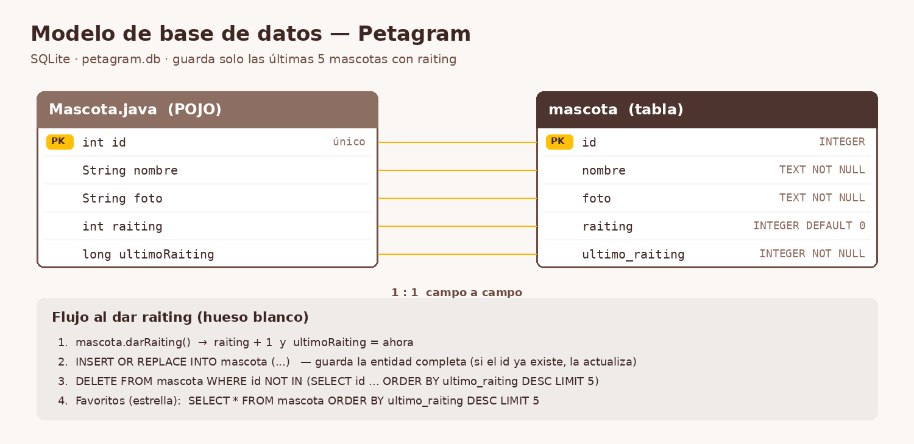

# Petagram

Aplicación Android (Java + Material Design) para ver y calificar con huesos las fotos de mascotas.

## Menús
- **Action View de estrella:** abre `FavoritosActivity` con 5 mascotas dummy y botón para subir.
- **Menú de opciones (⋮):**
  - **Contacto:** formulario con nombre, correo y mensaje (`TextInputLayout`). El botón **Enviar Comentario** manda el correo con **JavaMail** (`ContactoActivity`).
  - **Acerca De:** bio del desarrollador (`AcercaDeActivity`).

## Fragments + ViewPager
- `MainActivity` usa un **ViewPager2** con **TabLayout** y dos pestañas:
  - `RecyclerViewFragment`: la lista de mascotas con hueso blanco (dar raiting) y hueso amarillo (total).
  - `PerfilFragment`: perfil de la mascota con foto redonda (**CircularImageView**), nombre y un RecyclerView en **Grid** con sus fotos y raits (datos dummy).

## Librerías
- `com.sun.mail:android-mail` y `com.sun.mail:android-activation` (JavaMail)
- `com.mikhaellopez:circularimageview`
- AndroidX RecyclerView, ViewPager2 y Material Components

## Configurar el envío de correo
Las credenciales **no** están en el código. Agrega estas líneas al archivo `local.properties` (en la raíz del proyecto, no se sube a GitHub):

```
mail.usuario=tucorreo@gmail.com
mail.password=tu_contraseña_de_aplicacion
mail.destino=correo_que_recibe@gmail.com
```

Con Gmail hay que usar una **contraseña de aplicación** (Cuenta de Google → Seguridad → Verificación en 2 pasos → Contraseñas de aplicaciones).

## Persistencia (SQLite)
- El POJO `Mascota` tiene un **id único** que diferencia a cada mascota.
- La base de datos `petagram.db` (`db/BaseDatos.java`) tiene la tabla **mascota**, idéntica al POJO: `id`, `nombre`, `foto`, `raiting`, `ultimo_raiting`.
- Al tocar el **hueso blanco** se guardan los datos completos de la mascota y la tabla conserva solo las **últimas 5** mascotas con raiting.
- La pantalla de la **estrella** (`FavoritosActivity`) lee esas 5 mascotas de la base de datos.



El script del modelo está en [`docs/modelo_bd.sql`](docs/modelo_bd.sql).
